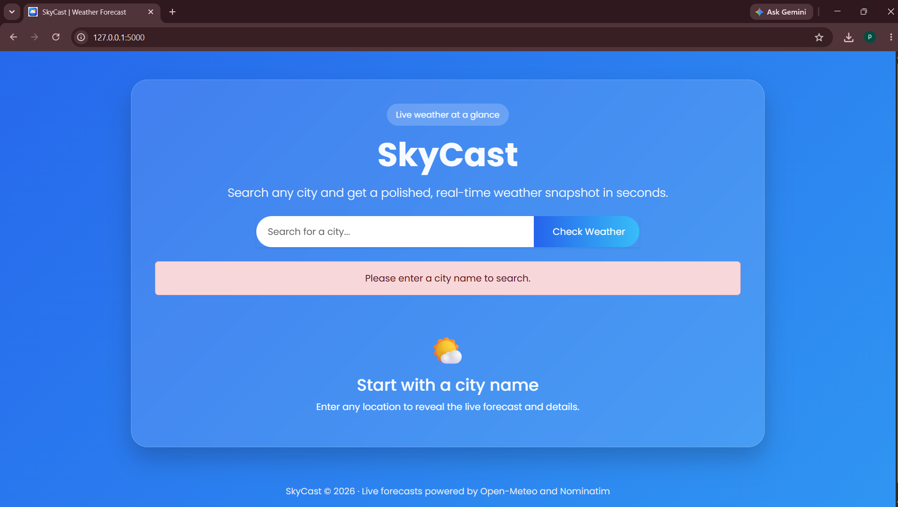
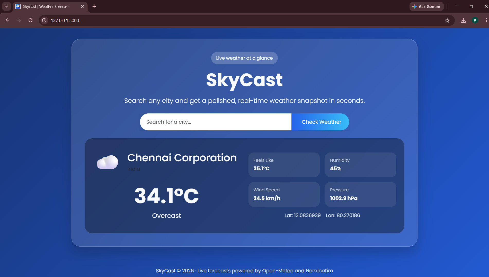
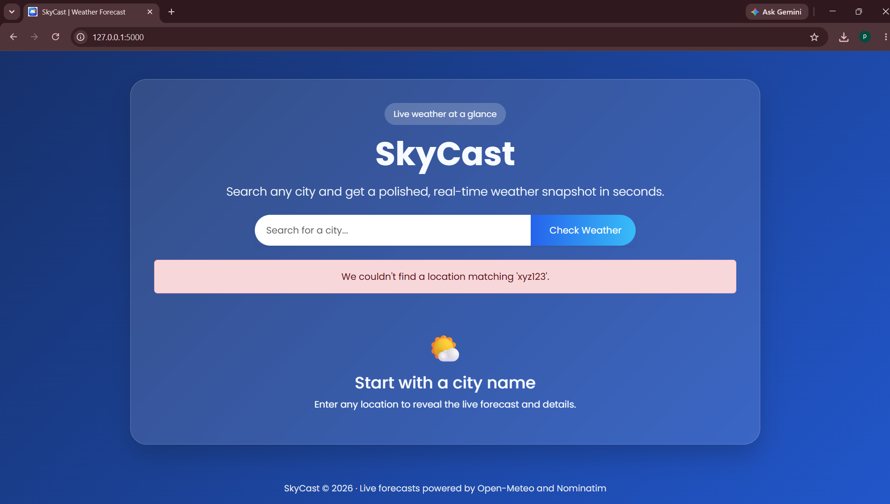

# SkyCast – Weather Application

SkyCast is a modern weather application built with **Flask** that provides real-time weather information for any city using the **Open-Meteo Weather API** and **Nominatim OpenStreetMap Geocoding API**. The application features a clean, responsive interface with a modern design and requires no API key.

## Project Overview

Users can search for any city to view its current weather conditions, geographic coordinates, and other useful weather information. The application first converts the city name into latitude and longitude using the Nominatim API, then retrieves live weather data from the Open-Meteo API.

## Features

- Search weather by city name
- Real-time weather information
- City and country details
- Temperature in Celsius
- Weather condition
- Wind speed
- Latitude and longitude
- Weather icon
- Responsive Bootstrap 5 interface
- Glassmorphism weather card
- Animated gradient background
- Loading indicator while fetching weather
- Input validation
- Friendly error messages for invalid city names
- No API key required

## Technologies Used

- Python
- Flask
- Requests
- HTML5
- CSS3
- Bootstrap 5
- Open-Meteo API
- Nominatim OpenStreetMap API

## Project Structure

```text
skycast/
│
├── app.py
├── requirements.txt
├── README.md
├── .gitignore
│
├── templates/
│   ├── base.html
│   └── index.html
│
├── static/
│   ├── css/
│   │   └── style.css
│   └── images/
│       └── icon.png
│
└── screenshots/
    ├── home.png
    ├── weather-result.png
    └── invalid-city.png
```

## Installation

Clone the repository:

```bash
git clone https://github.com/your-username/weatherapp.git
```

Navigate to the project folder:

```bash
cd weatherapp
```

Create a virtual environment (optional but recommended):

```bash
python -m venv venv
```

Activate the virtual environment.

**Windows**

```bash
venv\Scripts\activate
```

Install the required dependencies:

```bash
pip install -r requirements.txt
```

## Run the Application

```bash
python app.py
```

Open your browser and visit:

```
http://127.0.0.1:5000
```

## Screenshots

### Home Page



### Weather Result



### Invalid City



## APIs Used

### Nominatim OpenStreetMap

Used to convert city names into latitude and longitude.

### Open-Meteo

Used to retrieve live weather information based on geographic coordinates.

## Future Improvements

- Five-day weather forecast
- Hourly weather forecast
- Automatic location detection
- Temperature unit conversion
- Search history
- Dark mode

## Author

**Pretheka**

GitHub: https://github.com/pretheka-pre

---
